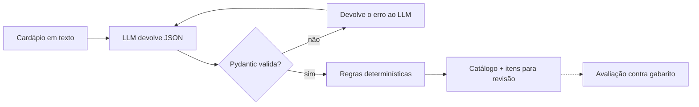

# CardápioAI

Transforma o cardápio de um restaurante em um catálogo estruturado para delivery: itens, preços, tamanhos, categorias e tags. O que o sistema não tem certeza vai para revisão humana, em vez de ser publicado errado.

## O problema

Restaurantes mandam cardápio em todo formato: texto de WhatsApp, PDF, foto. Alguém precisa transformar isso em itens cadastrados, com preço, categoria e tamanhos. É trabalho manual, repetitivo e sujeito a erro, e um preço errado no app vira prejuízo ou reclamação.

Um LLM resolve boa parte do trabalho, mas erra com confiança: inventa preço, troca categoria, esquece item. Este projeto trata o LLM como um componente que precisa ser validado e medido, não como uma caixa-preta confiável.

## Como funciona



1. **Extração:** o LLM recebe o cardápio e um prompt com formato e regras, e devolve JSON.
2. **Validação:** o Pydantic confere tipos, categorias e preços. Se falhar, o erro volta ao modelo para uma nova tentativa.
3. **Regras sem IA:** cada preço precisa existir no texto original, cada nome precisa aparecer no cardápio, preços fora da faixa e itens duplicados são marcados para revisão.
4. **Avaliação:** um conjunto de cardápios com gabarito feito à mão mede cobertura, precisão, acerto de preço, categoria e tags, além de tokens, tempo e custo.

## Decisões técnicas

| Decisão | Por quê |
|---|---|
| Saída estruturada validada com Pydantic | O resto do sistema só recebe dados no formato certo. Erro de formato vira nova tentativa, não exceção em produção. |
| Preços normalizados em código | "R$ 36,9" e "1.200,00" são convertidos de forma determinística. O modelo não precisa acertar formatação. |
| Checagem de alucinação por regras | Um preço que não existe no texto original é suspeito por definição. Essa checagem é barata, explicável e não depende de outro LLM. |
| Provedor de LLM trocável | O extrator conversa com uma interface. Dá para comparar modelos (Ollama local, OpenAI ou outro compatível) e testar tudo sem chamar API. |
| Avaliação com gabarito | Toda mudança de prompt ou modelo é medida. Sem número de antes e depois, não há como saber se melhorou. |
| Temperatura 0 | Respostas mais estáveis entre execuções, o que torna a avaliação comparável. |

## Rodando

Requisitos: Python 3.11 ou mais novo.

```bash
python -m venv .venv
source .venv/bin/activate        # no Windows: .venv\Scripts\activate
pip install -r requirements.txt
cp .env.example .env             # no Windows: copy .env.example .env
```

Configure o modelo no `.env`:

- **Grátis, local:** instale o [Ollama](https://ollama.com), baixe um modelo e coloque o nome dele em `LLM_MODELO`. Mantenha `LLM_BASE_URL=http://localhost:11434/v1`.
- **API:** qualquer provedor compatível com a API da OpenAI. Preencha `LLM_API_KEY`, `LLM_MODELO` e, se não for a OpenAI, `LLM_BASE_URL`.

Use:

```bash
python -m cardapio_ai extrair dados/cardapios/pizzaria_bella_nonna.txt
python -m cardapio_ai avaliar --detalhes
pytest
```

Os testes não chamam nenhum modelo: usam um provedor falso.

## Resultados

Cada linha é uma execução de `python -m cardapio_ai avaliar`. "Prontos" é a métrica principal: itens com nome, preço e categoria certos, que poderiam ser publicados sem correção.

| Data | Modelo | Prompt | Itens | Cobertura | Preço | Categoria | Prontos | Custo |
|---|---|---|---|---|---|---|---|---|
| _preencher_ | | v1 | 39 | | | | | |

**Métricas**

- **Cobertura:** itens do gabarito que o sistema encontrou.
- **Precisão:** itens extraídos que existem no gabarito (o resto é invenção ou divisão errada).
- **Preço, categoria, tags:** acerto entre os itens encontrados.
- **Prontos:** itens do gabarito encontrados com preço e categoria certos.
- **Revisão:** itens que as regras ou o modelo marcaram para conferência humana.

## Limitações conhecidas

- Por enquanto lê só texto. PDF e foto estão no roteiro.
- O conjunto de avaliação tem 3 cardápios e 39 itens. É pequeno para conclusões fortes.
- Cardápios muito longos podem passar do limite de contexto do modelo.

## Estrutura

```
cardapio_ai/
  models.py      formato do catálogo e validação (Pydantic)
  precos.py      conversão de preços escritos à mão
  prompts.py     prompt do sistema e prompt de correção
  llm.py         interface com o modelo e provedor falso para testes
  extrator.py    extração com nova tentativa em caso de erro
  regras.py      checagens sem IA que marcam itens para revisão
  avaliacao.py   comparação com gabarito e métricas
  cli.py         linha de comando
dados/
  cardapios/     cardápios fictícios de teste
  gabaritos/     resposta esperada de cada cardápio
tests/
```

## Próximos passos

- Ler cardápios em PDF e foto
- API com FastAPI e fila de revisão em banco de dados
- Integração com n8n: o cardápio chega por e-mail ou Telegram e os itens suspeitos vão para revisão
- Comparar modelos em acerto, custo e tempo
- Dividir cardápios longos em partes
- Serviço de catálogo em Java com Spring Boot, que recebe o JSON e publica os itens
